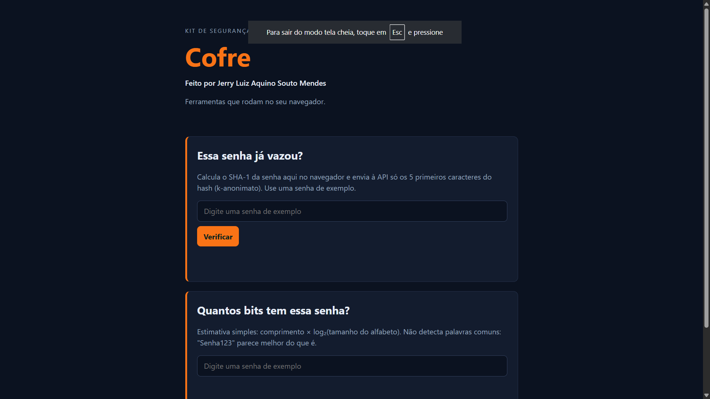

# Cofre: kit de segurança digital

**Veja funcionando:** [https://jerryluizaquino.github.io/cofre/](https://jerryluizaquino.github.io/cofre/)

## O que é

O cofre é um site com ferramentas simples para ajudar a entender a segurança das senhas. Ele verifica se tem vazamentos e estima sua força.

## Ferramentas

- **Essa senha já vazou?** Consulta uma base real de senhas vazadas sem enviar a senha (k-anonimato).
- **Quantos bits tem essa senha?** Estima a força da senha.
- **NOME DA SUA FERRAMENTA:** o que ela faz.

## O que eu aprendi

- Aprendi a criar e organizar commits para registrar as mudanças do projeto.
- Aprendi a trabalhar com branches e a resolver um conflito no Git.
- Aprendi que apagar um arquivo do projeto não remove esse arquivo do histórico do Git.

## Tecnologias

HTML, CSS, JavaScript, Git, GitHub Pages e a API Pwned Passwords.

## Sobre o histórico

O histórico tem um arquivo `.env` com uma senha falsa, de propósito: foi um exercício para mostrar que apagar um arquivo não apaga o que já foi publicado no Git.

## Créditos

Código-base do Prof. Mario Rebello, na disciplina Introdução à Ciência da Computação (2026/2).
A ferramenta NOME DA SUA FERRAMENTA é de minha autoria. Licença MIT.
